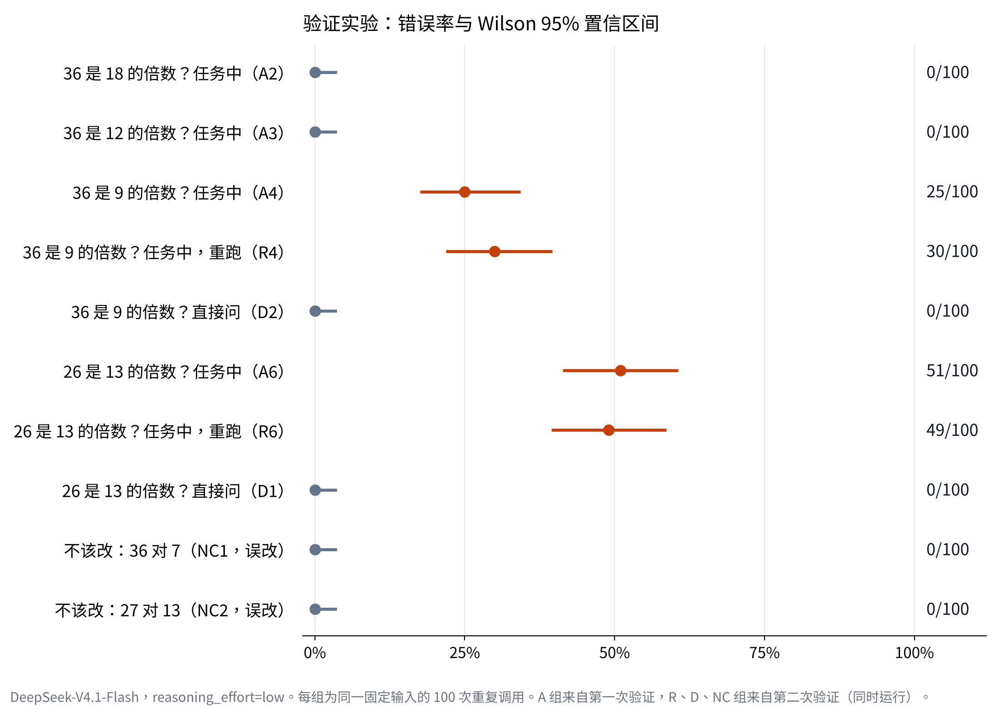
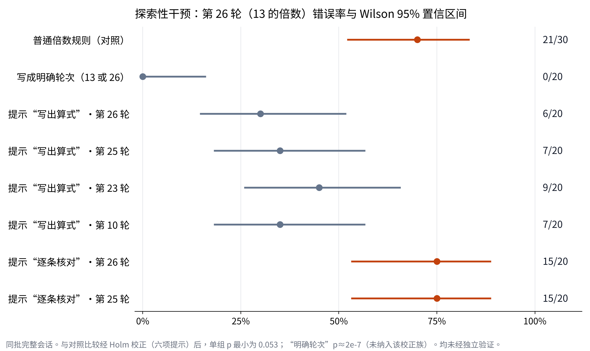

# DeepSeek 在任务中的整除判断失误

最初想研究“DeepSeek 在长任务里什么时候开始偏离规则”。实验最后观察到的是另一件事：在本研究的合成记账任务中，模型做简单的整除判断时经常不验算就下结论，而同样的问题单独问它时没有出错。

实验时间：2026-11-09 至 11-10。主要模型 `deepseek-flash`（DeepSeek-V4.1-Flash，`reasoning_effort=low`），部分对比用 `deepseek-v4-pro`。API 总花费约 141 元。

完整的实验设计、统计分析、每个结论的证据和局限，见 **[REPORT.md](REPORT.md)**（第 5 版，经过三次外部审查），Word 版见 `实验报告.docx`。两次验证实验的方案都在运行前写好并在本地锁定（[PREREG.md](PREREG.md)、[PREREG2.md](PREREG2.md) 和对应的 `_LOCK.txt`），哈希能证明方案此后没被改动，但锁定时间无法由第三方独立核实。

**适用范围：** 只测了 DeepSeek-V4.1-Flash 和两种人工合成任务；验证实验每组是同一条固定输入的 100 次重复调用，结论不能直接推广到其他任务。



## 主要发现

任务中的规则是：“轮次是 N 的倍数时，备注改以‘盘点’开头”。

**主要验证结果**

1. **同一数对，直接提问和在任务中判断的错误率明显不同。**

   | 判断 | 在记账任务中 | 直接问 |
   |---|---|---|
   | 26 是不是 13 的倍数 | 49/100、51/100 错（两次） | 0/100 错 |
   | 36 是不是 9 的倍数 | 30/100、25/100 错（两次） | 0/100 错 |
   | 36 是不是 18 的倍数 | 0/100 错 | 0/100 错 |
   | 36 是不是 12 的倍数 | 0/100 错 | — |

   这不支持“模型直接被问时就算不对”作为充分解释。但直接提问和任务判断之间有很多差别（规则数量、数据量、输出格式等），具体是哪一部分诱发了错误，还没有分离。

2. **“规则第二次生效（第 2N 轮）是高风险点”的推广不成立。** 这是探索阶段得出的猜想，验证实验中 36 是 18 的 2 倍，0/100 错。

**次要和探索性结果**

3. **错误几乎全是单向的。** 该改没改很常见，不该改却改了几乎没有（两组阴性对照各 0/100）。
4. **出错时思考中通常没有验算。** 出错的思考里大多直接写“26 不是 13 的倍数”；写出算式的 235 次判断全部正确。这是行为层面的描述，不是对内部机制的识别。
5. **候选对策（探索性，未独立验证）：** 把规则写成“第 13 轮或第 26 轮”这样的明确列表后 0/20 错，直接给出“34 = 17 × 2”后 0/30 错。“判断时写出算式”的提醒有一定帮助但证据较弱；“逐条核对规则”未检出改善。



**尚无结论**

6. 插入时机、思考档位、长对话（36/12：没有历史时 0/100，完整会话 4/20）、先前目标轮次和先前错误的作用。关于后者，不同实验和模型给出的结果不一致（报告 5.7 节）。

## 对“提前找出偏移点再干预”这个设想的回答

在同一个任务里，高风险轮次可以统计出来，并且能重复出现。但它取决于任务里具体的规则和数字，换一组数字就可能消失，不能推广成“第几轮容易出错”。值得进一步验证的对策是：把需要推理的条件改写成明确的列表或直接给出结果，而不是指望模型在长任务中每次都认真验算。

## 文件

- `scripts/`：实验脚本。需要在 `scripts/` 目录下新建 `.deepseek_key` 文件写入你自己的 API key（不要提交到 git）。
  - `drift_pilot.py`：基础记账任务和判分器
  - `drift_v2.py`：加入潜伏规则的 60 轮任务
  - `drift_v3.py`：措辞对照和不同周期
  - `drift_v4.py`：干预、每轮新会话、思考档位、模型等后续实验
  - `fork_34.py`：只重跑第 34 轮的干预实验
  - `code_task.py`：写代码的长任务
  - `classify.py`：把错误分为干净样本和受污染样本
  - `verify.py`：从原始日志重算描述性统计
  - `reanalysis.py`：配对检验、聚类模型、多重比较校正、功效分析
  - `export_prompts.py`：重建每轮输入消息，并用它对日志重新判分
  - `e2e_mixed.py`：端到端正确率和混合效应模型
  - `confirm_run.py`、`confirm_analysis.py`：两次验证实验的运行和分析
  - 每个脚本对应报告中的哪些数字，见报告附录 B.5
- `data/final2_errors.csv`：记账任务全部错误，734 条
- `data/intervention_samples.csv`：第 34 轮重跑的 360 条干预样本（不算自然错误率）
- `data/trigger_rates.csv`：各条件在规则触发轮的错误汇总
- `data/raw_logs.zip`：全部原始日志（探索性实验和验证实验），含模型回复和大部分批次的思考内容
- `data/prompts.zip`：每个批次的系统提示和每一轮的完整输入消息
- `data/analysis_outputs/`：各分析脚本的完整输出
- `data/run_logs/`：验证实验运行时的控制台记录和时间线
- `requirements.txt`：分析所用的库版本

## 运行示例

```bash
cd scripts
python3 drift_v4.py selftest
python3 drift_v4.py run --name demo --period 13 --turns 27 --runs 10 --out ../runs/demo
python3 drift_v4.py report ../runs/demo
```

脚本设了余额下限，低于 1 元自动停止。
